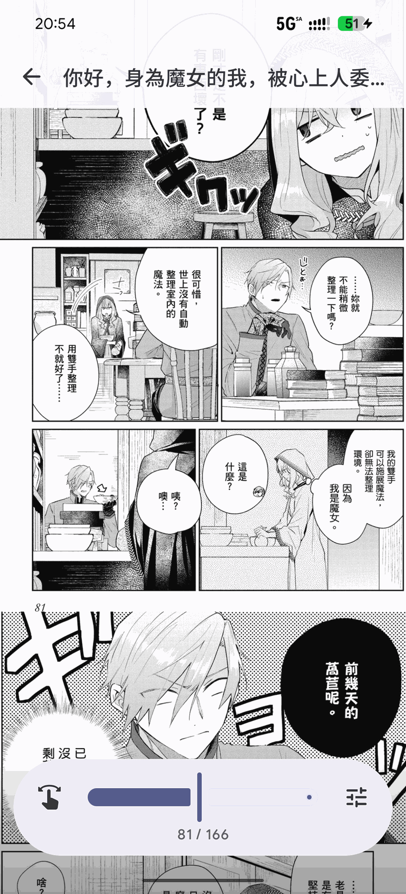
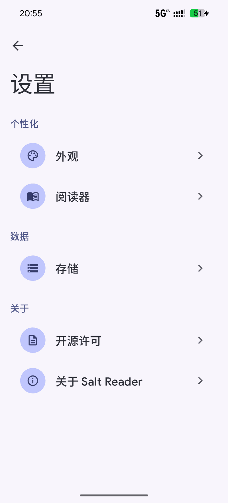

<p align="center">
  
</p>

<h1 align="center">Salt Reader</h1>

<p align="center">
  <strong>A local-first comic and ebook reader for Android.</strong>
</p>

<p align="center">
  <strong>Status:</strong> Beta · <code>1.0.0-beta.1</code> · Android 8.0 (API 26)+
  <br />
  <a href="https://github.com/PolarisSdesu/SaltReader/actions/workflows/android.yml"></a>
  <a href="README.zh-CN.md">简体中文</a>
</p>

---

## What it is — and isn't

Salt Reader isn't a library manager. It doesn't import books, build a collection in app storage, or ask for storage access. You grant a folder through Android's file picker; the app indexes what is already there and reads it in place. Revoke the grant and the books leave the shelf — the files were never moved.

There is no account, no sync service and no network permission. Everything happens on the device.

## Screenshots

[](readme/screenshot-library.png)
[](readme/screenshot-reader.png)
[](readme/screenshot-settings.png)

## Formats

| Format | How it is read |
|---|---|
| CBZ, ZIP | Pages read from the archive's central directory, nothing unpacked |
| PDF | Rendered with the system `PdfRenderer` |
| Image folder | Images in natural filename order |
| Image EPUB | Images from the EPUB spine |
| Text EPUB | Reflowed text, cover from the OPF |
| MOBI, AZW, AZW3 | Reflowed text; HUFF/CDIC compression is not supported |

## Reading

Comics page horizontally or scroll continuously. RTL, tap zones, pinch zoom, page slider.

Text pages have adjustable size, line spacing and margins, system or custom fonts with fallback order, a chapter list, and a page-number or percentage label. Pages are drawn by the platform WebView by default, or by an experimental native renderer: a Rust layout engine that draws on Compose Canvas. Paper colours are auto, white, sepia, green, ink or custom, and illustrations can run full width or stay inside the margins.

## Library

Covers come from the book's OPF, with a plain placeholder when there is none. The shelf supports search, filters, sorting and selectable card labels. Progress is stored per book; on Android 16+ it can also show as a Live Update notification.

## Permissions

No storage, all-files or network permission. The app can only read folders granted through the system picker, and that access can be revoked at any time. Notifications is the only runtime permission it may request, for the optional Live Update. The text reader blocks network requests and remote resources.

## Build

JDK 21 and Android SDK Platform 37.

```bash
./gradlew :app:assembleDebug     # debug APK
./gradlew :app:assembleRelease   # R8-minified release APK
./gradlew :app:testDebugUnitTest # JVM unit tests
```

For device testing, `-PfastRelease` skips R8, resource shrinking and release lint. CI and Play builds never pass it. The Gradle configuration cache is enabled; don't run `clean` between iterations.

## Contributing

- [Report bugs or suggest features](https://github.com/PolarisSdesu/SaltReader/issues).
- Translations live in `app/src/main/res/values*/`; every key must exist in all four locales.
- Patches should keep the existing style and pass `./gradlew :app:testDebugUnitTest`.
- The debug menu is hidden; tap the app logo five times on the About screen to unlock it.

## Third-party components

AndroidX, Compose, Kotlin and a vendored MOBI parser. Licenses are listed in [THIRD_PARTY_NOTICES.md](THIRD_PARTY_NOTICES.md).
