# Salt Reader

本地优先的 Android 漫画阅读器。包名 `moe.gbxin.saltreader`，使用 Jetpack Compose + Material 3 Expressive 实现。

## Play-ready 要点

- **无全盘权限**：不申请 `MANAGE_EXTERNAL_STORAGE`、`READ_EXTERNAL_STORAGE`，也不申请网络权限。
- **SAF 书库**：只读取用户在系统文件选择器中显式授权的目录（`OpenDocumentTree`），索引原文件，不复制漫画。
- **零格式转换**：CBZ/ZIP、图片型 EPUB、PDF、图片文件夹均直接读取原文件；文字型 EPUB/MOBI/AZW3 直接抽取正文交给原生 WebView 阅读，不再拍平转换成 CBZ。
- **不做导入副本**：应用私有目录只保存封面与 MOBI/AZW3 的章节文本缓存（`cacheDir/text/`）。
- **备份仅设置**：云备份 / 设备迁移只包含 `saltreader_settings`，书库索引与派生缓存永不备份。
- **release 开启 R8**：`isMinifyEnabled` + `isShrinkResources`，未使用的 Material 图标会被裁掉。
- `compileSdk 37` / `targetSdk 36` / `minSdk 26`，`versionCode 6` / `versionName 1.4.0`。

## 格式矩阵

| 格式 | 读取方式 | 转换 / 缓存 |
|---|---|---|
| CBZ / ZIP | 自研 `RemoteZipReader` 通过 SAF 可 seek 文件描述符直读中央目录，按条目 inflate 单页 | 零整包复制、零转换（仅解码缓存页） |
| 图片型 EPUB | `RemoteZipReader` 按 spine 顺序直读 EPUB 内的图片条目 | 零转换、零派生缓存 |
| 文字型 EPUB | `RemoteZipReader` 读 spine XHTML，原生 WebView 重排阅读 | 零转换（不落 CBZ） |
| MOBI / AZW3 | vendored `mobi-api4java` 抽取正文，原生 WebView 重排阅读 | 首次打开提取章节，缓存 `cacheDir/text/<id>_<mtime>_<size>.html`；清理缓存后重新提取 |
| PDF | 系统 `PdfRenderer` 按需渲染 | 无整本缓存 |
| 图片文件夹 | SAF 目录直读，图片按自然序 | 无 |

文字阅读（EPUB/MOBI/AZW3）统一支持：字号设置（14–28sp）、分页（CSS 多栏横向）/ 纵向滚动、按字符偏移记录进度（书架显示百分比）、RTL 翻页与音量键翻页。

## 功能

- **格式**：CBZ / ZIP / PDF / EPUB / MOBI / AZW3 / 图片文件夹
- **添加书库目录（SAF）**：在系统选择器中选中漫画所在文件夹，授予持久读取权限后原地索引；不复制原文件，也不扫描全盘
- **秒级索引**：只读 SAF 元数据与 ZIP 中央目录，几十本 CBZ/EPUB 也无需解压整本；MOBI/AZW3 的章节提取延迟到首次打开
- **存储页**：已添加目录（tree URI + 显示名）、刷新索引、移除目录、清理缓存与应用缓存占用
- **下拉刷新**：重新索引已记录的目录，按 `(modifiedAt, sizeBytes)` 增量跳过未变化的文件
- **PDF**：用系统 `PdfRenderer` 按需渲染，索引阶段只统计页数
- **单主页**：可收缩的大标题、封面自动提取（固定取文档第一页）、全部 / 在读 / 未读筛选、长按重命名或删除
- **布局面板**：右上角搜索旁的布局按钮，支持紧凑网格 / 松散网格 / 仅封面 / 列表、列数、书名大小、排序与方向
- **搜索**：右上角搜索图标打开独立搜索视图，实时按书名或作者过滤，返回回到书架
- **设置**：Material 3 Expressive 重构；`LargeFlexibleTopAppBar` 弹性大标题、28dp 分组卡片、带图标圆底色的设置行、`ButtonGroup` + `ToggleButton` 单选组与 Wavy 进度条；外观 / 阅读器 / 存储 / 关于四个二级页
- **图像阅读器**：横向翻页与纵向连续滚动、RTL（右到左）、沉浸模式、点击分区翻页、双指缩放、页码滑杆（实时预览 + 按页触感）、阅读进度持久化
- **文字阅读器**：EPUB/MOBI/AZW3 用原生 WebView 重排，字号滑杆、分页/滚动模式、字符偏移进度、RTL 翻页、音量键翻页，禁用远程资源
- **阅读设置**：底部标准 MD3 进度 Slider；点开为“阅读模式 / 常规 / 滤镜”三标签面板，含页码滑杆、方向、纸张、字号、常亮与灰度/反色滤镜；页码默认关闭沉浸显示
- **主题**：默认蓝色 MD3 色板；支持浅色 / 深色 / 跟随系统；Android 12+ 支持动态取色
- **空书架起步**：APK 不打包任何漫画，添加目录后建立书架

**权限：** 不申请任何存储或网络权限。可访问范围完全由用户通过 SAF 选择的目录决定；卸载应用或清除数据后，需要重新添加目录并授权。

## 快速开始：添加书库目录

1. 安装后首次打开是空书架。
2. 进入「设置 → 存储」，点击「添加文件夹」。
3. 在系统文件选择器中选中存放漫画的目录（可多选层级：压缩包、PDF、EPUB/MOBI/AZW3 文件，或含图片的文件夹）。
4. 确认授权：索引是秒级的（只扫描 SAF 元数据 / ZIP 中央目录）。索引完成后即可直接阅读，不需要等待任何转换；MOBI/AZW3 首次打开时会短暂提取章节文本。
5. 文件有增删或改名时，在「存储」页点「刷新索引」，或使用书架下拉刷新。

> 移除目录只会删除该目录下的索引与派生缓存，不会删除用户的任何文件。

## 截图

| 书架 | 搜索视图 | 设置 |
|---|---|---|
| 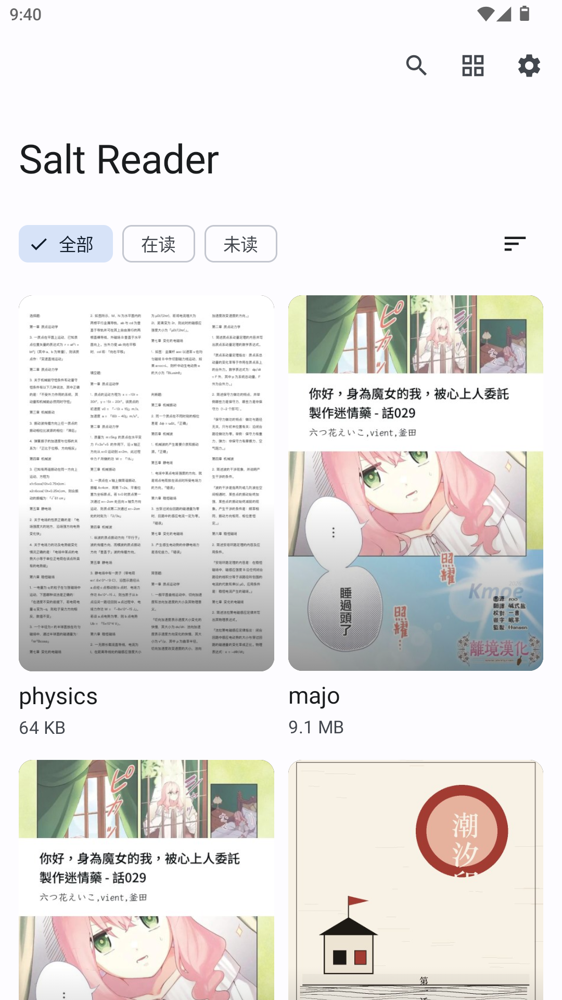 | 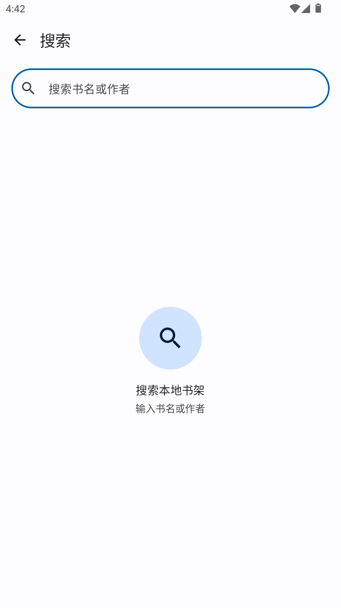 | 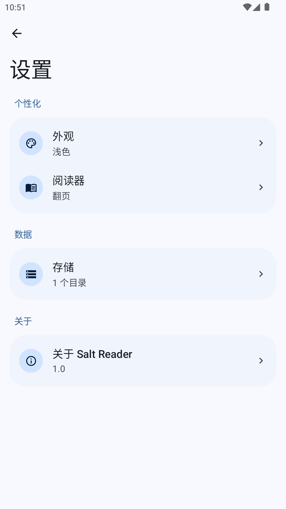 |

深色与纵向阅读：

| 深色书架 | 深色阅读器 |
|---|---|
| 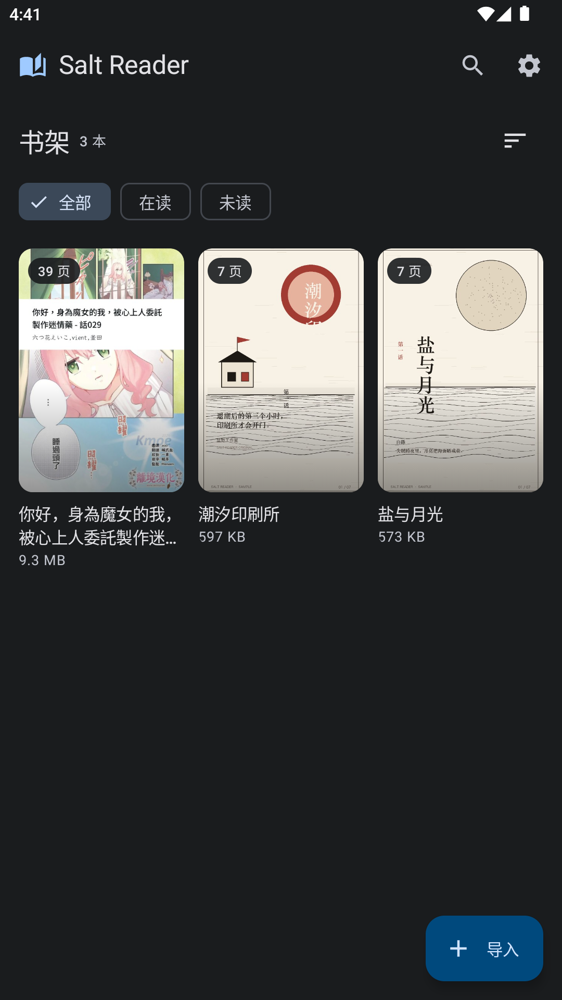 |  |

纵向模式与添加目录：

| PDF 阅读 | 添加目录 |
|---|---|
| 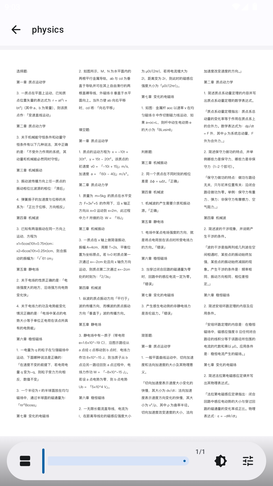 | 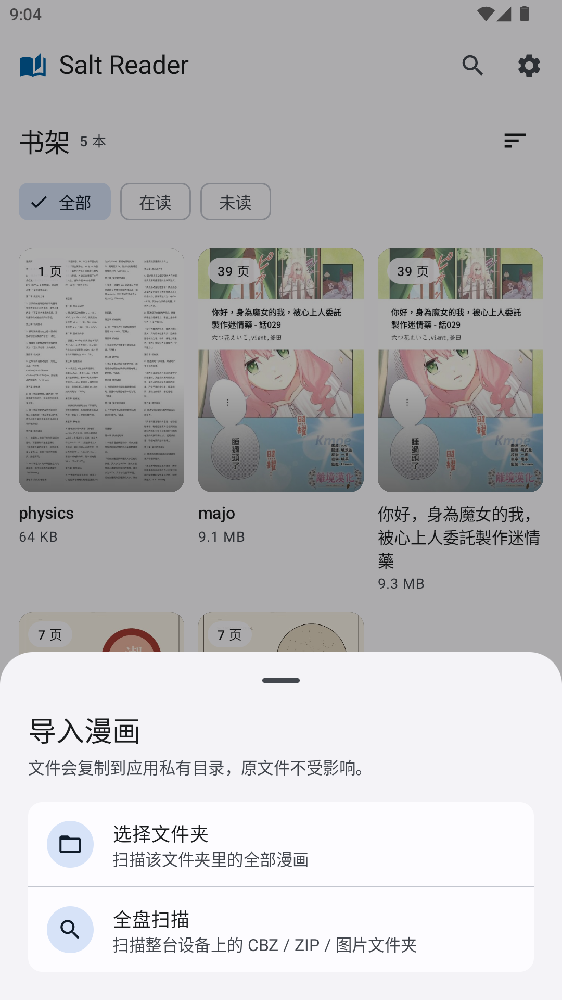 |

阅读进度与设置：

| 阅读进度 | 阅读控制面板 |
|---|---|
| 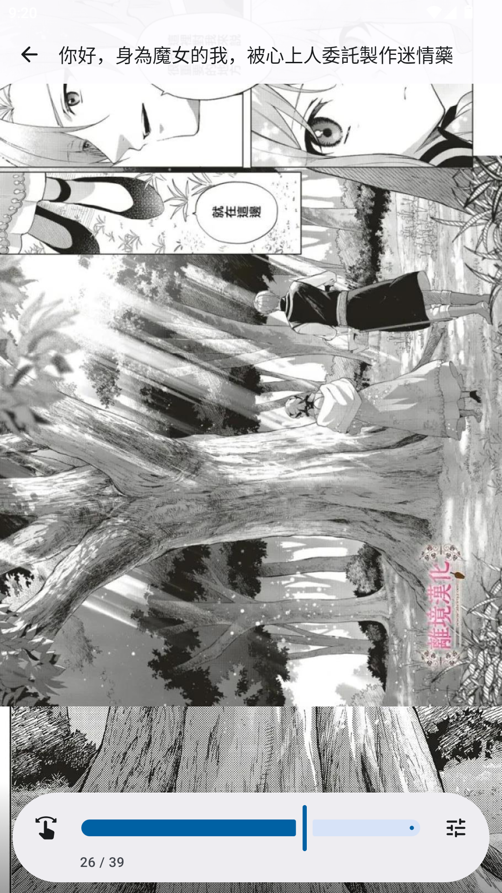 | 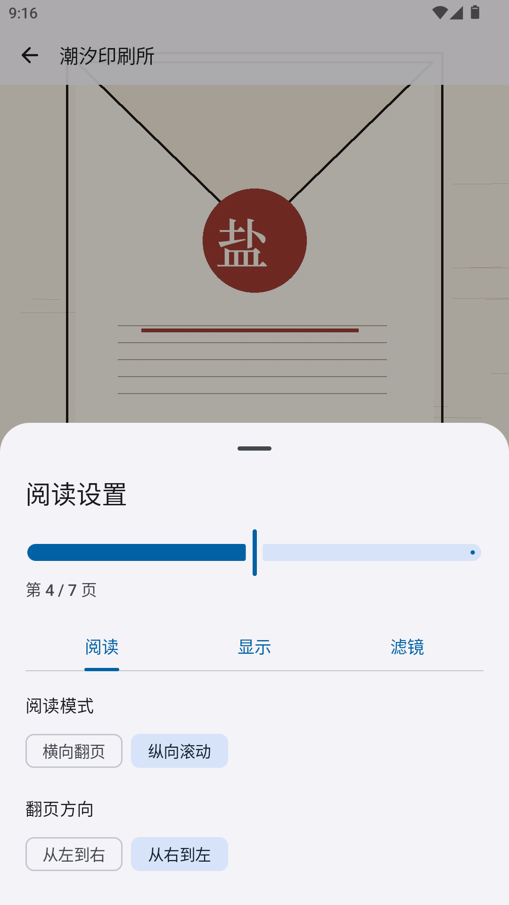 |

| 布局面板 | 存储页 |
|---|---|
| 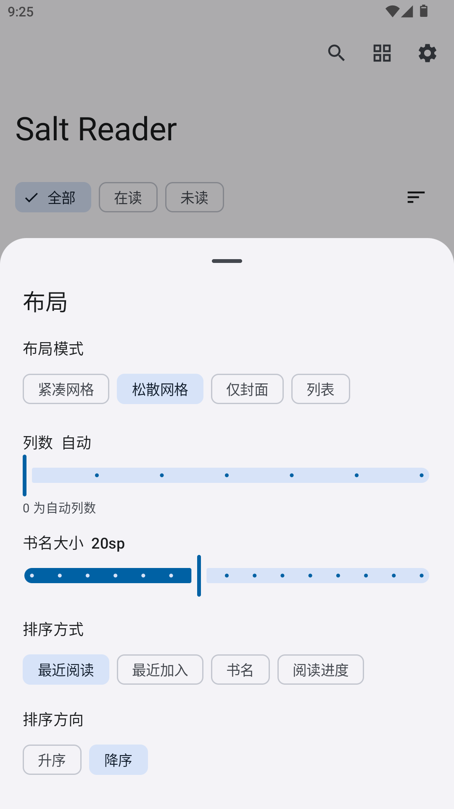 | 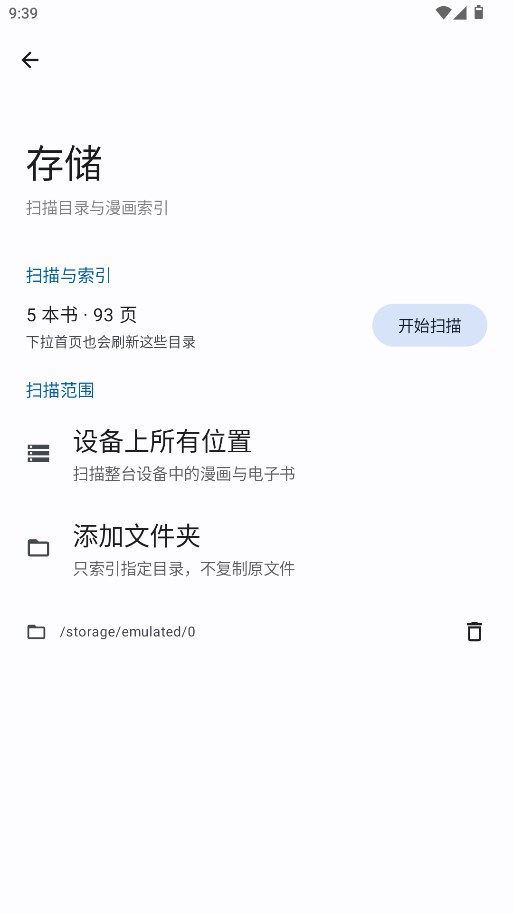 |

设置二级页（Material 3 Expressive）：

| 外观 | 阅读器 | 存储 | 关于 |
|---|---|---|---|
| 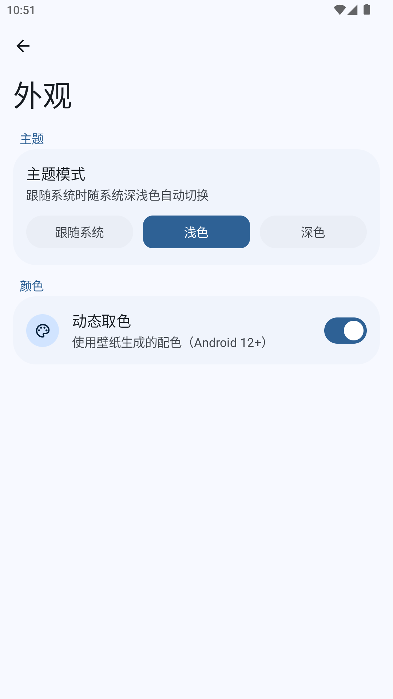 | 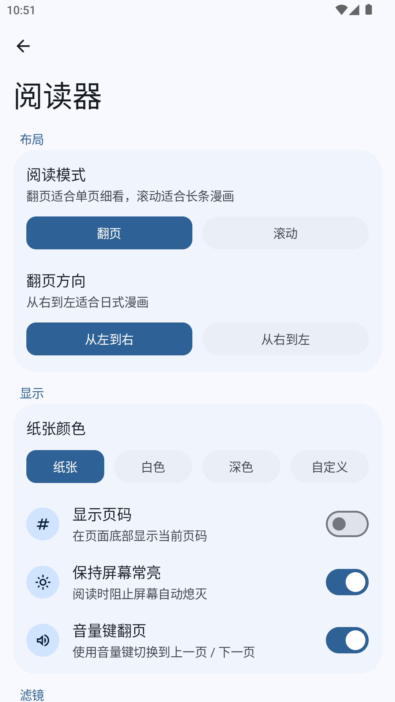 | 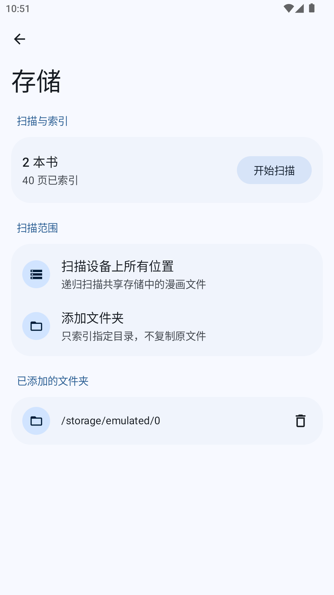 | 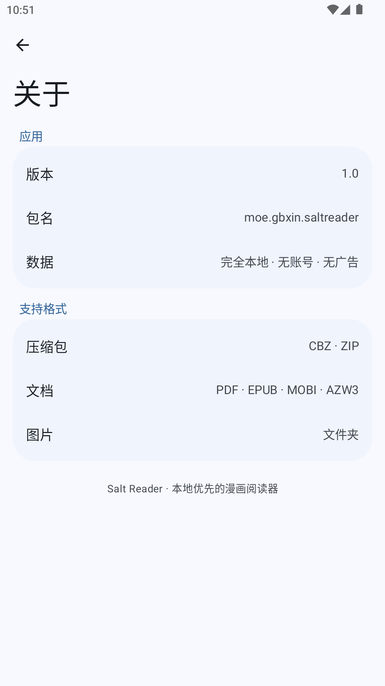 |

## 技术栈

| 层 | 选型 |
|---|---|
| UI | Jetpack Compose、Material 3 `1.5.0-beta02`（Expressive 组件）、`material-icons-extended`（R8 裁剪未用图标） |
| 架构 | 单 Activity、Compose 状态切换、ViewModel、StateFlow |
| 本地数据 | SAF tree URI + 应用私有目录中的 `books.json` / `roots.json`；SharedPreferences 保存设置 |
| 图片 | `BitmapFactory` + 自适应采样、Exif 方向修正、`LruCache` 页缓存 |
| 压缩包 | 自研 `RemoteZipReader`（EOCD/ZIP64 central directory + 按条目 inflate）；`PageIndexing` 保留流式回退 |
| 电子书 | 自研 `EpubIndexer` 直读 EPUB；文字阅读使用 Android 原生 `WebView`；MOBI/AZW3 用 vendored `mobi-api4java` 抽取正文；PDF 使用系统 `PdfRenderer` |
| 构建 | AGP 9.4.0、Gradle 9.7.1、Kotlin 2.3.21、compileSdk 37、minSdk 26 |
| 版本管理 | `gradle/libs.versions.toml` 作为唯一版本来源 |

## 构建

需要 JDK 21（Gradle daemon 使用 `gradle/gradle-daemon-jvm.properties` 指定的 toolchain 21）与 Android SDK Platform 37。

```bash
export JAVA_HOME="/Applications/Android Studio.app/Contents/jbr/Contents/Home"
./gradlew :app:assembleDebug
# APK: app/build/outputs/apk/debug/app-debug.apk
# applicationId: moe.gbxin.saltreader.debug（可与正式版共存）
```

> 当前 AGP 9.4 构建保留 `android.newDsl=false` + `android.builtInKotlin=false`，以显式使用外部 Kotlin Gradle Plugin 2.3.21（Compose / serialization 编译器插件都绑定该版本）。AGP 9.4 自带的 KGP 为 2.2.10，启用内建 Kotlin 前需要先做 Kotlin 版本对齐；该迁移暂未启用。

## Release 构建与签名

```bash
./gradlew :app:assembleRelease
# APK: app/build/outputs/apk/release/app-release.apk
```

- **R8**：release 已开启 `isMinifyEnabled=true` + `isShrinkResources=true`，使用 `proguard-android-optimize.txt`；`app/proguard-rules.pro` 中保留了 kotlinx.serialization、mobi4java 的保守 keep 规则，未使用的 Material 图标会被裁掉。构建完成后可直接比较 `app/build/outputs/apk/release/` 下 APK 体积（无 epub4j/zip4j/kxml2 等依赖后明显更小）。
- **版本规则**：`versionCode` 在每次向 Play 上传新版本时递增且不可回退（当前为 `6`）；`versionName` 采用语义化版本（当前 `1.4.0`）。两者都在 `app/build.gradle.kts` 的 `defaultConfig` 中维护。
- **签名材料**：默认读取根目录下被 `.gitignore` 排除的 `keystore.properties`（`storeFile` / `storePassword` / `keyAlias` / `keyPassword`）；也可以改用环境变量 `SALTREADER_KEYSTORE`、`SALTREADER_STORE_PASSWORD`、`SALTREADER_KEY_ALIAS`、`SALTREADER_KEY_PASSWORD`。两者都不存在时 release 产物为**未签名** APK，配置阶段不会失败（CI 会构建 debug/release 并跑单测，release 未签名但 R8 规则会被真实执行）。
- **keystore 治理**：`keystore/` 与 `keystore.properties` 已被 `.gitignore` 排除，请离线备份密钥库；不要把口令写进仓库或 CI 日志。建议启用 Play App Signing，由 Google 保管分发密钥，本地上传密钥仅用于上传。
- **TODO（上架前）**：把所有口令迁移到 CI secret / 本地环境变量，并在 Play Console 完成 App Signing 与内部测试轨道验证。

## 备份策略

产品决定：**只备份设置**。

- Android 12+（`res/xml/data_extraction_rules.xml`）：`cloud-backup` 与 `device-transfer` 都只 include `sharedpref/saltreader_settings.xml`，并显式排除 `saltreader_library.xml`、`file` 域（含 `library/` 与全部其他私有文件）、`database`、`external`。
- Android 11 及以下（`res/xml/backup_rules.xml`，`fullBackupContent`）：同样只 include 该设置文件，排除其余数据。
- 书库本体在用户自己的 SAF 目录中，永不复制、永不备份；封面与 `cacheDir/text/` 章节缓存同样不备份，换机后重新添加目录即可重建。

## 测试与 CI

```bash
./gradlew :app:testDebugUnitTest
```

纯 JVM 单元测试（无 Robolectric / Android framework 依赖）：

- `ComicBookSerializationTest`：`ComicBook` JSON 往返（含 `treeUri` / `documentPath` / `modifiedAt` / `reflowable` / `progressOffset` / `charCount`）、可选字段默认值、缺失 `treeUri` 的无效 JSON 被拒绝、未知字段忽略。
- `PageNameComparatorTest`：`1/2/10` 自然序、目录分组、大小写、公共前缀与数字后缀。
- `BookLogicTest`：`ComicBook.progress`（含 `finished` 与边界）、`pageLabel`（TEXT 百分比与各阅读状态）、`displayAuthor`、`kindLabel`、`ImportReport` 聚合。
- `EpubSpineClassifierTest`：图片型/文字型分类阈值、`estimateCharCount`（EPUB spine 与 MOBI/AZW3 文件体积）、`estimatePageCount`、字符偏移 ↔ 书架页/百分比换算。
- `RemoteZipReaderTest`：自研远程 ZIP 解析（central directory、DEFLATE/STORED 读取、按大小拒绝、图片条目自然序、损坏包拒绝）。
- `PageIndexingTest`：流式 ZIP 回退的图片计数 / 首图封面 / 损坏包处理、图片文件名过滤。
- `LibraryRootSerializationTest`：`roots.json` 的 `LibraryRoot` 往返、顺序保持、未知字段忽略。
- `FormatUtilTest`：`formatBytes` 的 B / KB / MB / GB 阈值，以及 `formatRelativeTime` 的空值与近期时间。

CI 见 `.github/workflows/android.yml`：JDK 21（Temurin）+ Gradle 构建缓存，执行
`./gradlew :app:assembleDebug :app:assembleRelease :app:testDebugUnitTest --no-daemon`，
并额外运行 `:app:lintDebug`（当前为 advisory，不阻塞合并）。

## 目录

```
app/src/main/java/moe/gbxin/saltreader/
  data/        ComicBook、SAF 书库仓库、RemoteZipReader/EpubIndexer、页源、设置
  ui/library/  书架、筛选、书籍操作
  ui/search/   独立搜索视图
  ui/reader/   图像分页阅读器 + WebView 文字阅读器、缩放、进度
  ui/settings/ Material 3 Expressive 设置首页与外观/阅读器/存储/关于二级页
  ui/theme/    MD3 蓝色 Scheme、形状、Expressive 主题
app/src/main/java/org/rr/mobi4java/            vendored MOBI/AZW3 文本解析
app/src/test/java/moe/gbxin/saltreader/        纯 JVM 单元测试（data/ 与 util/）
gradle/libs.versions.toml                      依赖/插件版本唯一来源
.github/workflows/android.yml                  CI
tools/
  convert_epub.py     开发辅助：按 EPUB spine 转 CBZ（应用运行时不使用）
  generate_samples.py 生成两本原创示例漫画
```

## 设计说明

界面遵循 MD3 的语义色 token、Roboto 类型比例、4/8/12/16/28dp 形状 token、4/8/12/16dp 间距和标准组件；Material 3 Expressive 用于阅读器浮动工具栏、加载指示、弹性动效，以及设置页的 `LargeFlexibleTopAppBar` 弹性顶栏、分段式 `ButtonGroup` 单选组与 `LinearWavyProgressIndicator` 扫描进度。设置页按二级页分组：外观 / 阅读器 / 存储 / 关于，组件规范来自 [hamen/material-3-skill](https://github.com/hamen/material-3-skill)。

## 格式限制

- PDF 使用系统 `PdfRenderer` 按需渲染；加密或损坏 PDF 会索引失败。
- 图片型 EPUB 按 spine 顺序取图，非图片资源忽略；文字型 EPUB 由 WebView 重排，复杂 CSS / MathML 不保证还原。
- MOBI/AZW 支持 PalmDOC 与未压缩文本；HUFF/CDIC 压缩的旧 MOBI 可能无法解析；首次打开需提取章节（有进度提示）。
- 目录只能通过 SAF 授权访问：应用不会读取未授权目录，也不支持直接填写文件系统路径。
- 文字阅读使用 WebView，禁用远程资源与脚本；复杂排版可能与原书有差异。

## 架构与许可

- SAF 书库架构与数据层契约：[docs/library-saf-architecture.md](docs/library-saf-architecture.md)
- 漫读 APK 分析：[docs/mandu-analysis.md](docs/mandu-analysis.md)
- 第三方许可见 [THIRD_PARTY_NOTICES.md](THIRD_PARTY_NOTICES.md)。
