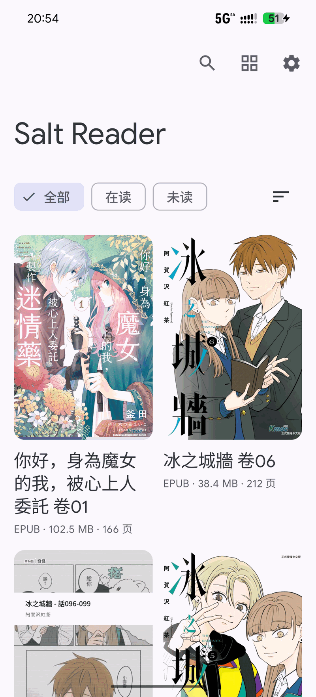

# Salt Reader 

[English](README.md) | [简体中文](README.zh-CN.md)


An Android reader for comics and ebooks. It indexes folders opened through the system file picker
and reads the files where they are, with no import step, no copy of the library and no storage
permission.

<br clear="all" />

## Screenshots

[](readme/screenshot-library.png)
[](readme/screenshot-reader.png)
[](readme/screenshot-settings.png)

## Download

Latest APK: [Releases](https://github.com/PolarisSdesu/SaltReader/releases/latest). One universal
build for arm64-v8a and x86_64, Android 8.0 (API 26) and newer. Current version: `1.0.0-beta.1`.

## Formats

| Format | How it is read |
| --- | --- |
| CBZ, ZIP | Pages read from the archive's central directory, nothing unpacked. |
| PDF | Rendered with the system `PdfRenderer`. |
| Image folder | Images in natural filename order. |
| Image EPUB | Images from the EPUB spine. |
| Text EPUB | Reflowed text, cover taken from the OPF. |
| MOBI, AZW, AZW3 | Reflowed text. HUFF/CDIC compression is not supported. |

## Features

Comics: horizontal paging or continuous scrolling, RTL, tap zones, pinch zoom, page slider.

Text: font size, line spacing, page margins, font choice (system fonts or your own font folder, with
ordered fallbacks), chapter list, page number or percentage. Pages can be drawn by the platform
WebView (default) or by an experimental native renderer: a Rust layout engine drawing on Compose
Canvas. Paper colours: auto, white, sepia, green, ink, custom. Illustrations can run full width or
stay inside the margins.

Library: OPF covers with a plain placeholder when missing, search, filter, sort, selectable card
labels, per-book progress, and a reading-progress Live Update notification on Android 16+.

UI: Material You dynamic colour, light and dark themes, AMOLED black. English, Simplified Chinese,
Traditional Chinese and Japanese.

## Permissions

No storage, all-files or network permission. The app can only read folders granted through the
system picker, and that access can be revoked at any time. The only runtime permission it may ask
for is notifications, for the optional Live Update. The text reader blocks network requests and
remote resources.

## Build

JDK 21 and Android SDK Platform 37.

```bash
./gradlew :app:assembleDebug     # debug APK
./gradlew :app:assembleRelease   # R8-minified release APK
./gradlew :app:testDebugUnitTest # JVM unit tests
```

`-PfastRelease` skips R8, resource shrinking and release lint for device testing. CI and Play builds
never pass it. The configuration cache is on; don't run `clean` between iterations.

## Contributing

- [Report bugs or suggest features](https://github.com/PolarisSdesu/SaltReader/issues).
- Translations live in `app/src/main/res/values*/`; every key must exist in all four locales.
- Patches should keep the existing style and pass `./gradlew :app:testDebugUnitTest`.
- The debug menu is hidden by default. Tap the app logo five times on the About screen to unlock it.

## Third-party components

AndroidX, Compose, Kotlin and a vendored MOBI parser. See
[THIRD_PARTY_NOTICES.md](THIRD_PARTY_NOTICES.md) for licenses.
