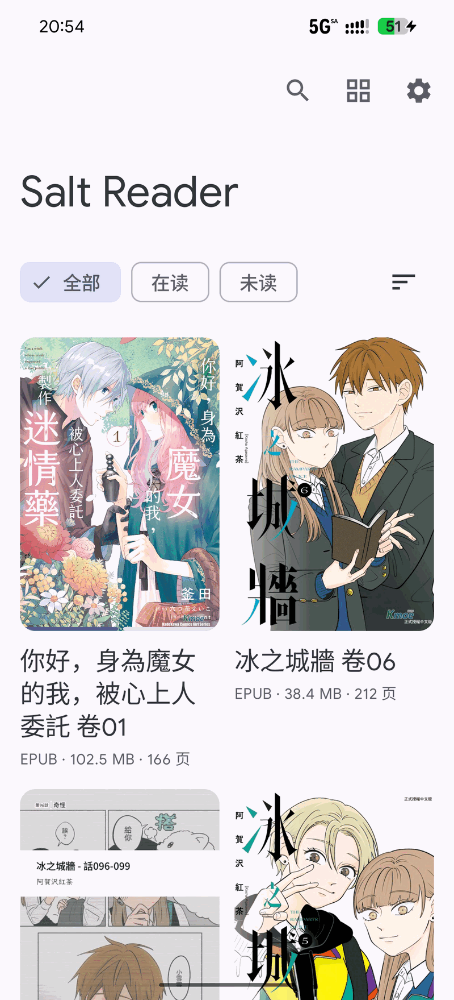
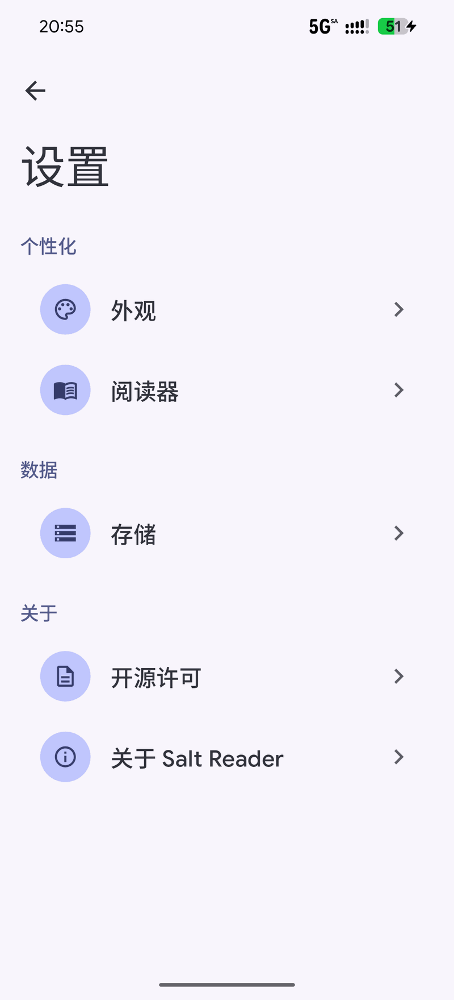

# Salt Reader 

[English](README.md) | [简体中文](README.zh-CN.md)


一个 Android 漫画与电子书阅读器。通过系统文件选择器授权文件夹后，应用在原地索引并读取文件：不导入、不复制书库，也不需要存储权限。

<br clear="all" />

## 截图

[](readme/screenshot-library.png)
[](readme/screenshot-reader.png)
[](readme/screenshot-settings.png)

## 下载

最新 APK 见 [Releases](https://github.com/PolarisSdesu/SaltReader/releases/latest)。单一通用包，支持 arm64-v8a 与 x86_64，要求 Android 8.0（API 26）及以上。当前版本：`1.0.0-beta.1`。

## 支持的格式

| 格式 | 读取方式 |
| --- | --- |
| CBZ、ZIP | 从压缩包中央目录直接读取页面，不解包。 |
| PDF | 交给系统 `PdfRenderer` 渲染。 |
| 图片文件夹 | 按文件名自然序读取。 |
| 图片型 EPUB | 按 EPUB spine 读取图片。 |
| 文字型 EPUB | 重排文字，封面取自 OPF。 |
| MOBI、AZW、AZW3 | 重排文字。不支持 HUFF/CDIC 压缩。 |

## 功能

漫画：横向翻页或纵向连续滚动，RTL，点击分区，双指缩放，页码滑杆。

文字：字号、行距、页边距，字体可选系统字体或自备字体（支持回退顺序），章节列表，页码或百分比显示。排版可由平台 WebView（默认）或实验性的原生渲染器完成：Rust 排版引擎，在 Compose Canvas 上绘制。纸张配色：自动、白、米色、浅绿、墨黑、自定义。插图可满宽显示，也可收在页边距内。

书库：封面取自 OPF，缺失时用纯色占位；搜索、筛选、排序；可选择书卡上显示的标签；按书记录进度；Android 16+ 可显示阅读进度 Live Update 通知。

界面：Material You 动态取色，深浅色主题，AMOLED 纯黑。English、简体中文、繁體中文、日本語。

## 权限

不声明存储、全盘或网络权限。只能读取通过系统选择器授权的文件夹，授权可随时撤销。唯一可能申请的运行时权限是通知，用于可选的 Live Update。文字阅读器会拦截网络请求与远程资源。

## 构建

需要 JDK 21 与 Android SDK Platform 37。

```bash
./gradlew :app:assembleDebug     # debug APK
./gradlew :app:assembleRelease   # 经过 R8 压缩的 release APK
./gradlew :app:testDebugUnitTest # JVM 单元测试
```

设备调试时可用 `-PfastRelease` 跳过 R8、资源压缩与 release lint；CI 与 Play 构建不会带这个参数。配置缓存默认开启；迭代时不要跑 `clean`。

## 参与贡献

- [反馈问题或提出建议](https://github.com/PolarisSdesu/SaltReader/issues)。
- 翻译位于 `app/src/main/res/values*/`，四种语言必须齐全。
- 提交代码请保持现有风格，并确保 `./gradlew :app:testDebugUnitTest` 通过。
- 调试菜单默认隐藏，在「关于」页连点应用图标 5 次解锁。

## 第三方组件

AndroidX、Compose、Kotlin，以及一份 vendored 的 MOBI 解析器。许可证见 [THIRD_PARTY_NOTICES.md](THIRD_PARTY_NOTICES.md)。
