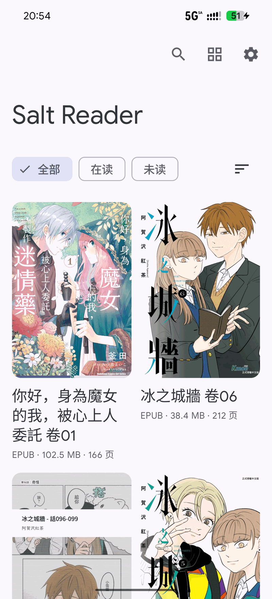
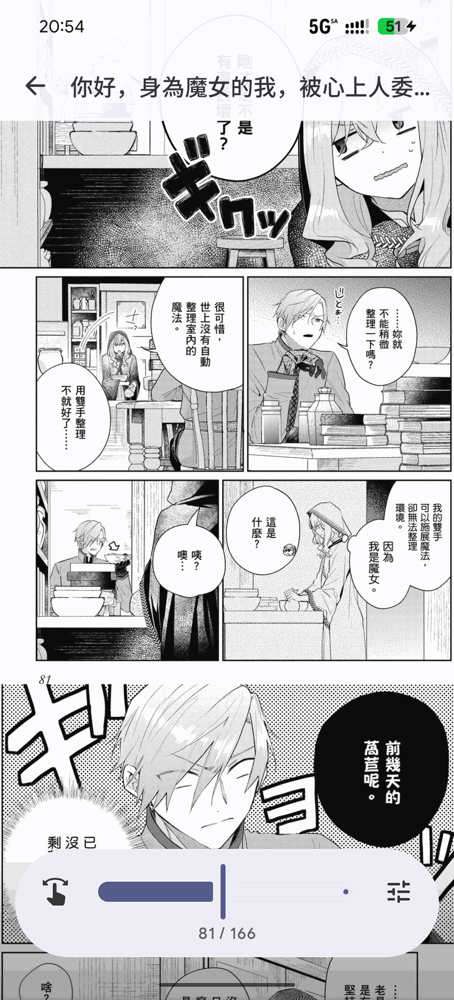
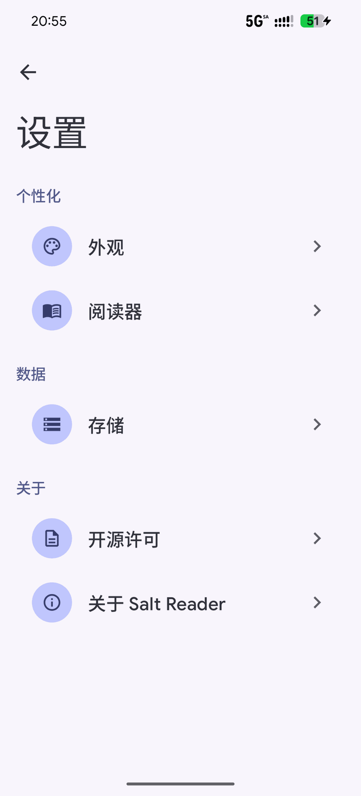

# Salt Reader 

[English](README.md) | [简体中文](README.zh-CN.md)


Salt Reader 是一个自由、本地优先的 Android 漫画与电子书阅读器。

它直接读取设备上的文件，支持 CBZ/ZIP、图片型与文字型 EPUB、MOBI/AZW3、PDF 以及图片文件夹。

<br clear="all" />

## 关于

多数漫画阅读器要么把书库复制到应用私有目录，要么申请宽泛的存储权限。Salt Reader 两者都不做：你通过 Android 的 SAF（存储访问框架）授权一个文件夹，应用只在你授权的范围内原地索引原始文件。

阅读器使用 Jetpack Compose 与 Material 3 Expressive 编写。图片按需解码；文字书交给系统 WebView 重排，因此字号、行距、页边距、分页/滚动、目录跳转和进度都不需要转换格式即可工作。

## 功能

Salt Reader 可以：

- 通过 SAF 添加书库目录，原地索引原始文件，不复制。
- 性能优先：压缩包只读中央目录建档、不解包；图片仅解码可见页；缩放整视口交给 GPU 合成，大书库和双指缩放依然跟手。
- 直接从授权目录读取 CBZ/ZIP，包括大文件。
- 按 spine 直接读取图片型 EPUB；文字型 EPUB/MOBI/AZW3 在原生阅读器中重排，带微信读书式底栏（目录/进度/主题/字体面板）、目录、字号/行距/页边距、宋体/黑体字体选择、页码或进度自由切换、跟手翻页，以及漫画与轻小说统一的阅读设置页。
- 文字型 EPUB 从 OPF 提取真实封面显示在书架；确实没有封面的书使用纯色占位。
- 通过系统 `PdfRenderer` 打开 PDF，按自然序打开图片文件夹。
- 横向翻页或纵向连续滚动，支持 RTL、点击分区翻页、双指缩放和页码滑杆。
- 搜索书库，按全部 / 在读 / 未读筛选，自定义布局与书卡标签。
- 跟随系统深浅色、Material You 动态取色，可选 AMOLED 纯黑模式，并可选择阅读纸张配色（自动 / 白 / 米色 / 浅绿 / 黑 / 自定义）。
- 使用 English、简体中文、繁體中文或日本語界面。
- 不申请存储或网络权限：只能访问你明确授权的目录。

## 截图

[](readme/screenshot-library.png)
[](readme/screenshot-reader.png)
[](readme/screenshot-settings.png)

## 权限

Salt Reader 不声明存储、全盘或网络权限。它能读取的内容全部来自你在系统文件选择器中授权的目录，授权可随时撤销。

文字阅读器会阻止网络加载与远程资源，只渲染本地书籍内容。

## 参与贡献

Salt Reader 是一个小型开源项目，欢迎参与：

- [反馈问题或提出建议](https://github.com/PolarisSdesu/SaltReader/issues)。
- 改进翻译（English、简体中文、繁體中文、日本語 文案位于 `app/src/main/res/values*/`）。
- 提交代码。请保持现有风格，并确保 `./gradlew :app:testDebugUnitTest` 通过。

## 构建

需要 JDK 21 与 Android SDK Platform 37。

```bash
./gradlew :app:assembleDebug     # debug APK
./gradlew :app:assembleRelease   # R8 压缩后的 release APK
./gradlew :app:testDebugUnitTest # JVM 单元测试
```

## 第三方组件

Salt Reader 构建在 AndroidX、Compose 与 Kotlin 生态之上，并包含一份 vendored 的 MOBI 解析器。
完整列表与许可证见 [THIRD_PARTY_NOTICES.md](THIRD_PARTY_NOTICES.md)。
